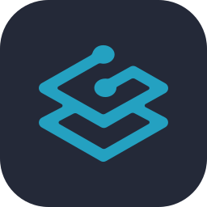
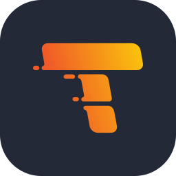
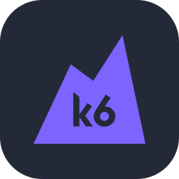
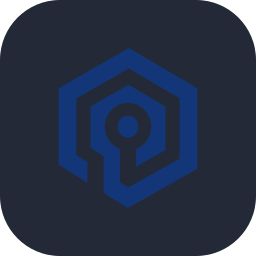
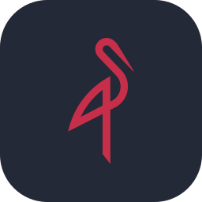
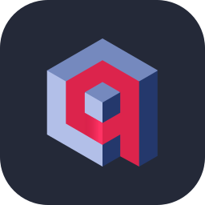
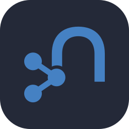
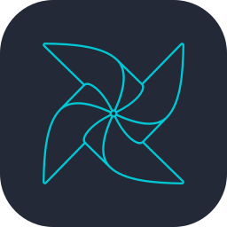
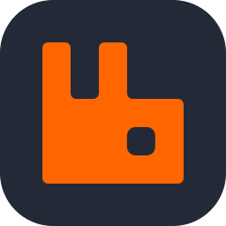
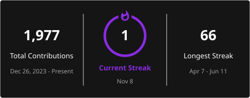

<table align="center">
<tr>
<td align="center" width="300">

</td>
<td align="center">

</td>
</tr>
</table>

### 🧠 About Me

I'm an AI & Data Science student who loves turning ideas into things that actually run. I've worked across machine learning, full-stack apps, and hardware — and lately I'm getting hooked on **DevOps**: automating, deploying, and making systems reliable. I learn best by building, breaking, and rebuilding.

### 🚀 What I'm Up To

- 🔧 Diving into **DevOps** — Docker, Kubernetes, CI/CD, infra as code
- 🌱 Always up for learning something new & experimenting
- 🤝 Open to collaborations, internships & interesting problems
- 💬 Ask me about **AI/ML, Data Science, or hardware**

### 🎨 Technical Palette

<table width="100%">
<tr>
<td width="24%"><b>Languages</b></td>
<td>     </td>
</tr>
<tr>
<td width="24%"><b>Cloud &amp; DevOps</b></td>
<td>        </td>
</tr>
<tr>
<td width="24%"><b>Observability &amp; Testing</b></td>
<td>      </td>
</tr>
<tr>
<td width="24%"><b>Databases &amp; Storage</b></td>
<td>        </td>
</tr>
<tr>
<td width="24%"><b>Data Engineering</b></td>
<td>    </td>
</tr>
<tr>
<td width="24%"><b>AI/ML &amp; Frameworks</b></td>
<td>     </td>
</tr>
</table>

### 📬 Connect with Me

### ✨ Fun Fact

I get way too excited when a pipeline goes green on the first try. 🟢 Serial breaker-and-fixer of my own setups.

### 📊 Profile Pulse

###  Contribution Snake

<picture>
<source media="(prefers-color-scheme: dark)" srcset="https://raw.githubusercontent.com/maanu-v/maanu-v/output/github-contribution-grid-snake-dark.svg">
<source media="(prefers-color-scheme: light)" srcset="https://raw.githubusercontent.com/maanu-v/maanu-v/output/github-contribution-grid-snake.svg">

</picture>

