


 


 


 

<table width="100%">
<tr>
<td width="24%"><b>Languages</b></td>
<td>     </td>
</tr>
<tr>
<td width="24%"><b>Cloud &amp; DevOps</b></td>
<td>        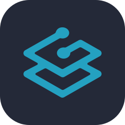</td>
</tr>
<tr>
<td width="24%"><b>Observability &amp; Testing</b></td>
<td>   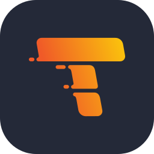  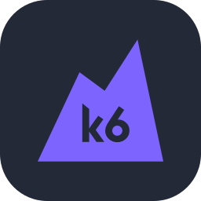 </td>
</tr>
<tr>
<td width="24%"><b>Databases &amp; Storage</b></td>
<td>    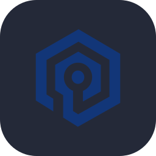  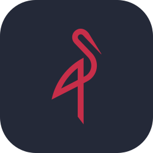 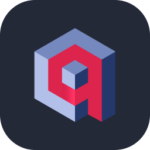 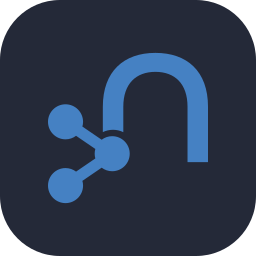</td>
</tr>
<tr>
<td width="24%"><b>Data Engineering</b></td>
<td> 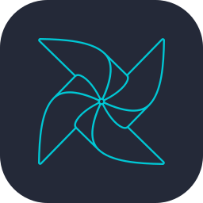  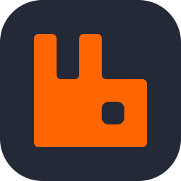 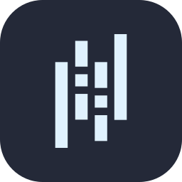</td>
</tr>
<tr>
<td width="24%"><b>AI/ML &amp; Frameworks</b></td>
<td>   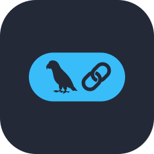  </td>
</tr>
</table>

 

  

  

  

 

I get way too excited when a pipeline goes green on the first try. 🟢 Serial breaker-and-fixer of my own setups.

 

  
  
  
  

